# Arquitetura — Fademy API

Como o código é organizado e por quê. As regras de negócio ficam em `docs/SPEC.md`; este
documento trata só da estrutura. Mudou a estrutura, muda este documento no mesmo PR.

## 1. Stack

| Item | Escolha |
|---|---|
| Linguagem | Java 25 |
| Framework | Spring Boot 4.1 (só na camada de infraestrutura) |
| Build | Maven, pelo wrapper `./mvnw` (não precisa instalar Maven) |
| Postgres | PostgreSQL 17 + Flyway (migrations) + Spring JDBC (`JdbcClient`, SQL escrito à mão) |
| Mongo | MongoDB 8 + driver oficial (`MongoClient` do Singleton) |
| Imagens | MongoDB GridFS (bucket `imagens`), pelo `MongoAdapter` do Singleton; servidas pela própria API em `GET /api/media/<chave>` (#62) |
| Tempo real | Socket.IO v4 com `socket.io-server-java`, dentro do Tomcat (mesma porta da API; o `netty-socketio` exigiria outra porta e o React conecta na URL da API) |
| Autenticação | JWT HS256 + bcrypt |
| Testes | JUnit 5, Mockito, AssertJ, Testcontainers (Postgres e Mongo reais), ArchUnit |

## 2. Camadas (Clean Architecture)

```
             ┌──────────────────────────────────────────────────┐
             │ infrastructure  (Spring, JDBC, Mongo, HTTP)      │
             │   ┌──────────────────────────────────────────┐   │
             │   │ application  (use cases, services,       │   │
             │   │               interfaces de gateway)     │   │
             │   │   ┌──────────────────────────────────┐   │   │
             │   │   │ domain  (entidades e regras)     │   │   │
             │   │   └──────────────────────────────────┘   │   │
             │   └──────────────────────────────────────────┘   │
             └──────────────────────────────────────────────────┘
                 as dependências apontam só para dentro
```

**Regra de dependência** (verificada por teste ArchUnit, falha o build):

- `domain` não depende de nenhum outro pacote do projeto nem de biblioteca externa
  (nem Spring, nem JPA, nem Jackson).
- `application` depende só de `domain`. Nada de Spring aqui também.
- `infrastructure` depende de `application` e `domain`, e é o único lugar com Spring.

Consequência: dá para testar toda regra de negócio sem banco e sem subir o Spring.

## 3. Pacotes

```
src/main/java/br/com/fademy/
├── domain/
│   ├── usuario/        Usuario (abstrata), Aluno, MembroDaEquipe, Professor, Coordenador,
│   │                   Funcionario, Administrador, Papel
│   ├── instituicao/    Instituicao, Categoria, TipoCategoria
│   ├── convite/        Convite, SituacaoConvite
│   ├── social/         Seguir, StatusSeguir, Bloqueio
│   ├── conteudo/       Post, Comentario
│   ├── notificacao/    Notificacao, TipoNotificacao
│   ├── conversa/       Conversa, Mensagem
│   └── excecao/        RegraDeNegocioException, RecursoNaoEncontradoException, ...
├── application/
│   ├── usecase/        interfaces:  RegistrarViaConviteUseCase, SeguirUsuarioUseCase, ...
│   ├── service/        implementações: RegistrarViaConviteService implements RegistrarViaConviteUseCase
│   └── gateway/        interfaces:  UsuarioGateway, ConviteGateway, NotificacaoGateway,
│                       ArmazenamentoGateway, SenhaGateway, TokenGateway, TempoRealGateway,
│                       TransacaoGateway, ...
└── infrastructure/
    ├── database/       DatabaseManager (Singleton), DatabaseConfig
    ├── postgres/       PostgresXxxGateway (SQL com JdbcClient)
    ├── mongo/          MongoXxxGateway (driver do MongoDB)
    ├── armazenamento/  S3ArmazenamentoGateway
    ├── seguranca/      JwtTokenGateway, BcryptSenhaGateway, filtro de autenticação
    ├── web/            controllers, DTOs (record), tratamento de erro
    ├── temporeal/      servidor Socket.IO (polling + WebSocket JSR-356), salas por usuário;
    │                   TempoRealEmTodosOsCanais entrega a mensagem nova no Socket.IO e no TCP
    ├── socket/         chat pelo terminal: ServidorTcp, ClienteHandler, ClientesConectados,
    │                   TcpTempoRealGateway (socket TCP "na mão", como no exemplo da aula)
    └── config/         UseCaseConfig (monta services com seus gateways), CargaInicial
```

Nomes de classe e de método em português, como no exemplo do professor.

## 4. Use case → service → gateway

Todo caso de uso segue o mesmo formato:

```java
// application/usecase — o que o sistema faz
public interface SeguirUsuarioUseCase {
    ResultadoSeguir executar(String visualizadorId, String alvoId);
}

// application/service — como faz; Java puro, recebe gateways pelo construtor
public class SeguirUsuarioService implements SeguirUsuarioUseCase {
    private final UsuarioGateway usuarios;
    private final SeguirGateway seguires;
    private final BloqueioGateway bloqueios;
    private final NotificacaoGateway notificacoes;
    ...
}

// application/gateway — o que o service precisa do mundo lá fora
public interface SeguirGateway {
    Optional<Seguir> buscar(String seguidorId, String seguidoId);
    Seguir salvar(Seguir seguir);
    ...
}

// infrastructure/postgres — o Adapter concreto
public class PostgresSeguirGateway implements SeguirGateway { ... }
```

- Controllers recebem **a interface do use case**, nunca o service.
- Services recebem **interfaces de gateway**, nunca a implementação.
- Quem liga cada service aos gateways é `infrastructure/config/UseCaseConfig`, com `@Bean`.
  Os services não têm anotação do Spring.
- Implementações de gateway são `@Component` (a infraestrutura pode usar Spring) e são
  injetadas nos services pela interface.
- Gateway devolve e recebe **entidades de domínio**. A conversão de/para linha do Postgres
  ou documento do Mongo acontece dentro da implementação do gateway.
- Sem JPA nem Spring Data: cada gateway escreve o próprio SQL (ou consulta Mongo). Com JPA,
  cada entidade precisaria de três classes a mais (entidade JPA, repositório, conversor); o
  SQL direto é mais simples e deixa o gateway como um Adapter fino sobre a conexão do
  Singleton, como no exemplo do professor.

### Transação

O service não conhece Spring, então não usa `@Transactional`. Ele pede uma transação ao
`TransacaoGateway`:

```java
Usuario criado = transacao.executar(() -> {
    Usuario usuario = usuarios.criar(novo);
    if (!convites.consumirVaga(convite.id())) {          // SPEC RN13, RN46
        throw new DadosInvalidosException("Invite has no remaining slots");
    }
    return usuario;
});
notificacoes.criar(...);   // MongoDB, depois do commit (RN47)
```

A implementação (`SpringTransacaoGateway`) usa o `TransactionTemplate` do Spring.

### Notificação como efeito colateral

O contrato do `NotificacaoGateway` diz que ele nunca lança exceção (SPEC RN37): a
implementação no Mongo registra a falha no log. Assim nenhum service precisa repetir
`try/catch` em volta de cada notificação.

## 5. Domínio com comportamento

As entidades guardam dado **e** regra. Exemplos do que sai dos controllers do Node e vira método:

| Regra (SPEC) | Onde fica |
|---|---|
| Permissões por papel (RN05) | Polimorfismo na hierarquia de `Usuario` (seção 5.1) |
| Situação e consumo de vaga do convite (RN11, RN13) | `Convite.situacao(agora)`, `Convite.consumirVaga()` |
| Seguir perfil privado nasce pendente (RN21) | `Seguir.solicitar(seguidor, alvo)` |
| Só o alvo aceita e só se pendente (RN23) | `Seguir.aceitarPor(usuarioId)` |
| Link só para quem pode (RN28) | `Post.publicar(autor, texto, link, ...)` pergunta `autor.podePublicarLink()` |
| Mensagem precisa de texto ou mídia (RN41) | construtor de `Mensagem` |
| Só membro envia (RN41) | `Conversa.garantirMembro(usuarioId)` |

### 5.1 Hierarquia de usuários

```mermaid
classDiagram
    class Usuario {
        <<abstract>>
        -String id
        -String instituicaoId
        -String nome
        -String email
        -String senhaHash
        -String avatarUrl
        -boolean privado
        -boolean ativo
        +papel() Papel*
        +podeGerarConvite() boolean
        +podeGerarConvitePara(Papel alvo) boolean
        +podePublicarLink() boolean
        +podeAcessarPainelAdmin() boolean
        +mesmaInstituicao(Usuario outro) boolean
        +tornarPrivado(boolean privado)
        +trocarAvatar(String url)
    }
    class Aluno
    class MembroDaEquipe {
        <<abstract>>
        +podeGerarConvite() true
        +podePublicarLink() true
    }
    class Professor
    class Coordenador
    class Funcionario
    class Administrador {
        +podeGerarConvitePara(Papel alvo) true
        +podeAcessarPainelAdmin() true
    }
    Usuario <|-- Aluno
    Usuario <|-- MembroDaEquipe
    MembroDaEquipe <|-- Professor
    MembroDaEquipe <|-- Coordenador
    MembroDaEquipe <|-- Funcionario
    MembroDaEquipe <|-- Administrador
```



`Usuario` responde `false` para todas as permissões; cada subclasse libera o que o papel
permite. Um `Papel.criarUsuario(...)` (fábrica) monta a subclasse certa a partir do papel
gravado no banco. Nenhum código fora do domínio compara papel por texto.

## 6. Singleton `DatabaseManager` + Adapters

Segue o exemplo do professor (`docs/referencias/exemplo-singleton-adapter/`):

```java
public class DatabaseManager {
    private static DatabaseManager instance;

    private final PostgresAdapter postgresAdapter;   // pool de conexões do PostgreSQL
    private final MongoAdapter mongoAdapter;         // cliente e banco do MongoDB

    private DatabaseManager() {
        ConfiguracaoBancos config = ConfiguracaoBancos.doAmbiente();
        postgresAdapter = new PostgresAdapter(config.postgresUrl(), ...);
        mongoAdapter = new MongoAdapter(config.mongoUri(), ...);
        postgresAdapter.conectar();
        mongoAdapter.conectar();
    }

    public static DatabaseManager getInstance() {
        if (instance == null) {
            instance = new DatabaseManager();
        }
        return instance;
    }

    public PostgresAdapter getPostgresAdapter() { ... }
    public MongoAdapter getMongoAdapter() { ... }
}
```

- `DataBaseAdapter` é a interface do exemplo (`conectar()`, `desconectar()`), implementada por
  `PostgresAdapter` (guarda o `DataSource` do HikariCP) e `MongoAdapter` (guarda o `MongoClient`
  e o `MongoDatabase`). Como no exemplo, o construtor privado do `DatabaseManager` cria os
  adapters, e o Singleton os entrega (#61).
- O `MongoAdapter` também grava e lê os arquivos (`salvarArquivo`, `existeArquivo`,
  `lerArquivo`) no GridFS, como o `salvarUsuario` do exemplo; o `MongoArmazenamentoGateway`
  usa esses métodos (#62).

- `ConfiguracaoBancos.doAmbiente()` lê `POSTGRES_URL`, `POSTGRES_USER`, `POSTGRES_PASSWORD`
  e `MONGO_URI` (variável de ambiente ou propriedade de sistema). Sem elas, usa os valores do
  `docker-compose` em `localhost`, como o exemplo do professor.
- `DatabaseConfig` (Spring) chama `getInstance()` **na subida** e expõe os dois adapters como
  beans; o `DataSource`, o `MongoClient` e o `MongoDatabase` saem de dentro deles. Flyway,
  `JdbcClient` e os gateways do Mongo usam esses beans. No desligamento, o Spring chama
  `desconectar()` dos dois adapters.
- Os gateways (`PostgresXxxGateway`, `MongoXxxGateway`) implementam as interfaces de
  `application/gateway` usando a conexão que o adapter do banco guarda.
- **Ninguém além do `DatabaseConfig` chama `getInstance()`.** Services e gateways recebem as
  conexões por injeção.
- Nos testes de integração, os containers do Testcontainers sobem uma vez por execução e
  preenchem essas propriedades de sistema antes do primeiro `getInstance()`.

**Por que o `getInstance` sem `synchronized` é seguro aqui.** O servidor atende requisições
em várias threads. Se duas threads chamassem `getInstance` pela primeira vez ao mesmo tempo,
as duas poderiam ver `instance == null` e criar dois pools de conexão. Isso não acontece
porque a primeira chamada é feita na subida, numa única thread, antes de o servidor aceitar
requisições; daí em diante `instance` já existe e toda chamada só devolve o mesmo objeto.
Um teste garante que o objeto usado pelo Spring é o mesmo que `getInstance` devolve.

## 7. Web

- Tempo real: `SocketIoConfig` sobe o servidor Socket.IO no Tomcat (servlet assíncrono para o
  polling e endpoint JSR-356 para o WebSocket, os dois em `/socket.io/`); `SalasSocketIo`
  autentica a conexão pelo `TokenGateway` e põe cada uma na sala do usuário.
- Chat pelo terminal (SPEC RN50): `ServidorTcp` abre um `ServerSocket` junto com a aplicação
  (`SmartLifecycle`) e cria uma `Thread` com um `ClienteHandler` para cada conexão, como o
  `Servidor` do exemplo de sockets da disciplina. O `ClienteHandler` lê as linhas e o
  `ServidorTcp` traduz cada comando em use case (`AutenticarUseCase`, `ListarConversasUseCase`,
  `MensagensUseCase`), sem regra de negócio, como um controller. `ClientesConectados` é a lista
  de clientes logados (`CopyOnWriteArrayList`); o `TcpTempoRealGateway` usa essa lista para
  entregar a mensagem nova. Como o `MensagensService` recebe um só `TempoRealGateway`, o
  `TempoRealEmTodosOsCanais` (`@Primary`) repassa para o Socket.IO e para o TCP.
- Imagens: o domínio e os bancos guardam só a **chave** no armazenamento; a URL é detalhe de
  apresentação. `EnderecoDasImagens` (infra web) monta `IMAGENS_URL_PUBLICA + "/" + chave` na hora de
  responder, nos DTOs e no evento em tempo real. Assim o endereço pode mudar (outro IP) sem
  quebrar as imagens gravadas (#53).
- DTOs de entrada e saída são `record`s em `infrastructure/web`, com os nomes de campo do
  contrato (`_id`, `authorId`, ...) — ver SPEC seção 5.
- Exceções de domínio viram status HTTP num `@RestControllerAdvice`:

| Exceção | Status |
|---|---|
| `DadosInvalidosException` | 400 |
| `NaoAutenticadoException` | 401 |
| `AcessoNegadoException` | 403 |
| `RecursoNaoEncontradoException` | 404 |
| `ConflitoException` | 409 |
| qualquer outra | 500 `Internal server error` |

  Corpo sempre `{ "error": "<mensagem>" }`, com a mensagem exata do SPEC.
- A autenticação é um `HandlerInterceptor` (`Autenticacao`) nas rotas `/api/**` que não são
  públicas (lista em `WebConfig`). Ele valida o JWT pelo `TokenGateway` e guarda o
  `Visualizador` (`id`, `papel`, `instituicaoId`) na requisição; o controller o recebe como
  parâmetro. Por ser interceptor, o 401 passa pelo `TratadorDeErros` como qualquer erro.
- A permissão por papel é decidida pelo domínio (`usuario.podeGerarConvite()`), não por
  anotação no controller.

## 8. Ids

- Postgres: UUIDv7, gerado na aplicação (biblioteca `uuid-creator`). Por ser ordenado pelo
  tempo, `id < cursor` funciona como no ObjectId do Node e a paginação por cursor (SPEC 5.4)
  não muda.
- Mongo: ObjectId.
- Para o domínio e para o frontend, id é sempre `String`.

## 9. Ambiente local

```bash
docker compose up -d        # postgres:17 e mongo:8 (as imagens ficam no GridFS do mongo)
./mvnw spring-boot:run      # API em http://localhost:8080
./mvnw verify               # testes unitários + integração (Testcontainers precisa do Docker)
```

Na apresentação (rede local da faculdade): a API sobe no notebook, o frontend é servido com
`VITE_API_URL=http://<ip-do-notebook>:8080` e `FRONTEND_ORIGIN` aponta para o endereço do
frontend. Sem internet: as imagens ficam no MongoDB local e a própria API as serve.

## 10. Testes

| Camada | Tipo | Ferramenta |
|---|---|---|
| domain | unitário puro | JUnit + AssertJ |
| application (services) | unitário com gateways falsos | JUnit + Mockito |
| infrastructure (gateways) | integração com banco real | Testcontainers (Postgres, Mongo) |
| web | contrato HTTP (status, corpo, mensagens do SPEC) | `@SpringBootTest` + MockMvc |
| arquitetura | regra de dependência da seção 2 | ArchUnit |
