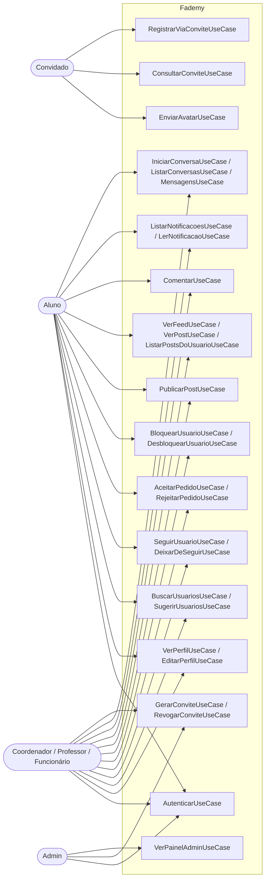
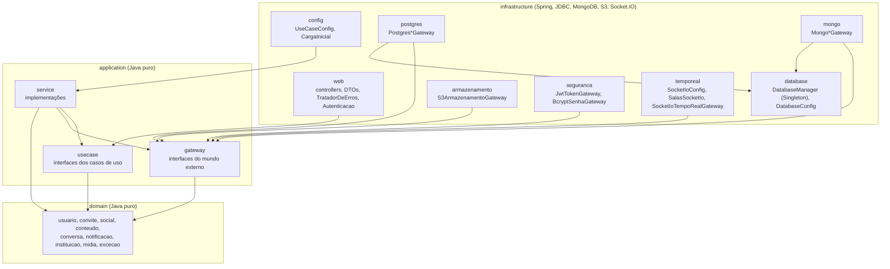
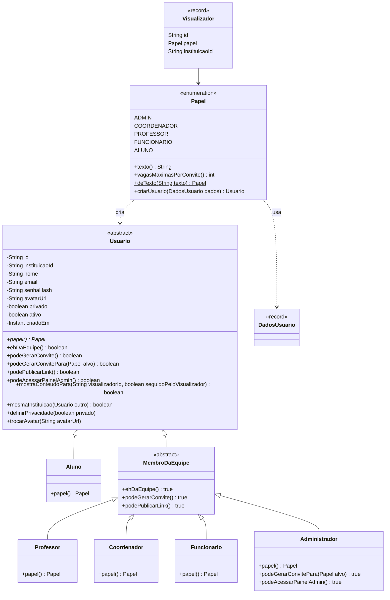
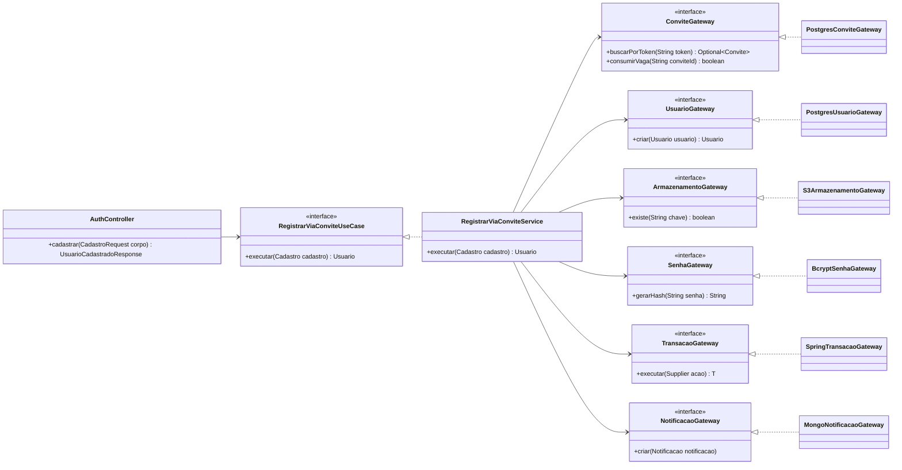
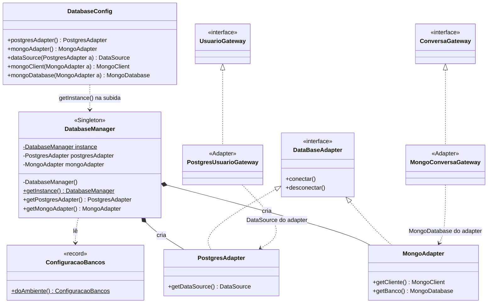
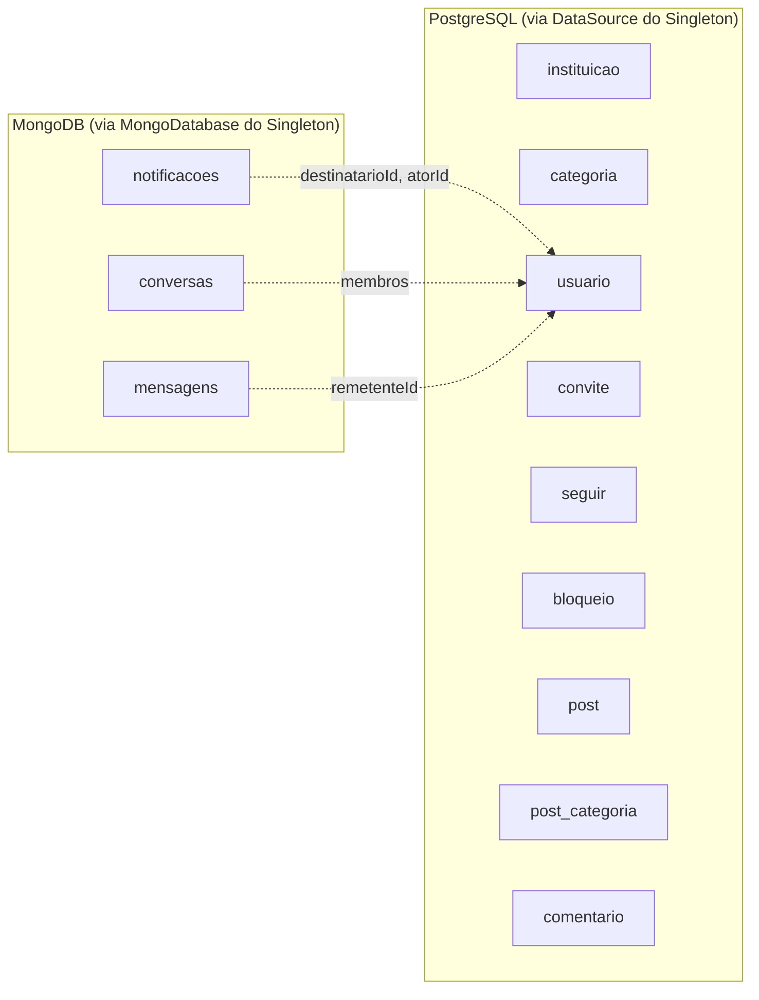
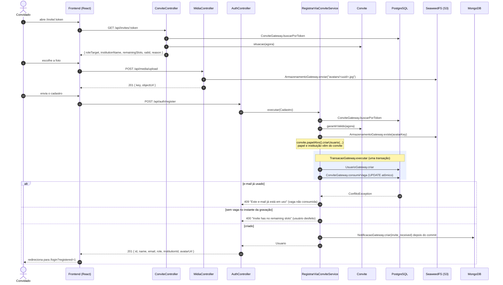

# Diagramas — Fademy API

Diagramas do projeto em Java, em Mermaid (o GitHub desenha direto nesta página). Todos os
nomes de classe e de método são os do código. Nos diagramas de classe, os métodos de acesso
(`id()`, `nome()`...) foram omitidos para caber.

A análise de POO do projeto antigo (`docs/referencias/analise-sobre-poo.txt`) apontava que o
diagrama de lá era de **dados**. Estes são de **classes**: mostram comportamento, herança,
polimorfismo e as dependências entre as camadas.

1. [Casos de uso](#1-casos-de-uso)
2. [Camadas e pacotes](#2-camadas-e-pacotes)
3. [Domínio](#3-domínio)
4. [Use case, service e gateway](#4-use-case-service-e-gateway)
5. [Singleton e Adapters](#5-singleton-e-adapters)
6. [Sequência: cadastro via convite](#6-sequência-cadastro-via-convite)

---

## 1. Casos de uso

Cada caso de uso do diagrama original virou uma interface em `application/usecase`.

A equipe faz tudo o que o aluno faz e também gera convites e publica links; o admin, além
disso, acessa o painel. Essa diferença não é `if` no código: é a hierarquia da seção 3.

## 2. Camadas e pacotes

As setas são dependências de código. Elas só apontam para dentro, e o teste
`ArquiteturaTest` (ArchUnit) quebra o build se alguém inverter uma delas.

## 3. Domínio

### 3.1 Usuários: herança e polimorfismo

`Usuario` responde `false` para todas as permissões; cada subclasse libera o que o papel
permite. `Papel.criarUsuario` é a fábrica que monta a subclasse certa a partir do papel gravado.

### 3.2 Entidades com comportamento

Cada regra de negócio sobre um objeto é método dele. O service só orquestra.

```mermaid
classDiagram
    class Convite {
        -Papel papelAlvo
        -String token
        -int maxUsos
        -int usos
        -StatusConvite status
        -Instant expiraEm
        +gerar(Usuario autor, String papelAlvo, Integer maxUsos, Instant expiraEm, Instant agora)$ Convite
        +situacao(Instant agora) SituacaoConvite
        +garantirValido(Instant agora)
        +vagasRestantes() int
        +revogar()
        +daInstituicao(String instituicaoId) boolean
    }
    class StatusConvite {
        <<enumeration>>
        ACTIVE
        REVOKED
        EXPIRED
    }
    class SituacaoConvite {
        <<enumeration>>
        VALIDO
        REVOGADO
        EXPIRADO
        CHEIO
        +valido() boolean
        +motivo() String
    }
    class Seguir {
        -String seguidorId
        -String seguidoId
        -StatusSeguir status
        +solicitar(Usuario seguidor, Usuario alvo, Instant agora)$ Seguir
        +notificacaoParaOSeguido() TipoNotificacao
        +garantirQueEhOSeguido(String usuarioId)
        +aceitarPor(String usuarioId)
    }
    class StatusSeguir {
        <<enumeration>>
        PENDING
        ACCEPTED
    }
    class Post {
        -String texto
        -List~String~ imagens
        -String linkUrl
        -List~String~ categoriaIds
        -int comentarios
        +publicar(Usuario autor, String texto, String linkUrl, List~String~ categoriaIds, Instant agora)$ Post
        +anexarImagem(String url)
        +temLink() boolean
        +daInstituicao(String instituicaoId) boolean
        +notificaAutorSobreComentarioDe(Usuario comentarista) boolean
    }
    class Comentario {
        <<record>>
        +escrever(Usuario autor, String postId, String texto, Instant agora)$ Comentario
    }
    class Conversa {
        <<record>>
        List~String~ membros
        +entre(Usuario criador, Usuario outro, Instant agora)$ Conversa
        +temMembro(String usuarioId) boolean
        +garantirMembro(String usuarioId)
        +outroMembro(String usuarioId) String
    }
    class Mensagem {
        <<record>>
        String texto
        List~String~ midias
        +escrever(String conversaId, String remetenteId, String texto, int quantidadeDeImagens, Instant agora)$ Mensagem
        +comMidias(List~String~ urls) Mensagem
    }
    class Notificacao {
        <<record>>
        TipoNotificacao tipo
        boolean lida
        +nova(TipoNotificacao tipo, String destinatarioId, String atorId, String refId, Instant agora)$ Notificacao
        +garantirDestinatario(String usuarioId)
    }
    class TipoNotificacao {
        <<enumeration>>
        NEW_FOLLOWER
        FOLLOW_REQUEST
        FOLLOW_ACCEPTED
        POST_COMMENT
        INVITE_RECEIVED
        MESSAGE_RECEIVED
        +texto() String
        +modeloReferencia() String
    }
    class Imagem {
        <<record>>
        +aceita(String tipo)$ boolean
        +novaChave(String pasta) String
    }
    class Categoria {
        <<record>>
        +fixas()$ List~Categoria~
    }

    Convite --> StatusConvite
    Convite ..> SituacaoConvite
    Convite ..> Usuario : autor
    Seguir --> StatusSeguir
    Seguir ..> TipoNotificacao
    Seguir ..> Usuario
    Post ..> Usuario : autor
    Post "1" o-- "*" Categoria : categoriaIds
    Comentario ..> Post : postId
    Conversa "1" o-- "*" Mensagem : conversaId
    Notificacao --> TipoNotificacao
```

## 4. Use case, service e gateway

O caso de uso mais completo, o cadastro via convite, com todas as peças. O controller
conhece só a interface do use case; o service conhece só interfaces de gateway; quem liga
cada service às implementações é o `UseCaseConfig`.

O mesmo desenho se repete nos outros 29 casos de uso: `XxxUseCase` (interface) ←
`XxxService` (implementação) → `YyyGateway` (interface) ← `PostgresYyyGateway` /
`MongoYyyGateway` / ... (implementação).

## 5. Singleton e Adapters

### 5.1 Exemplo do professor × Fademy

| Exemplo do professor (`docs/referencias/exemplo-singleton-adapter/`) | Fademy |
|---|---|
| `DatabaseManager.getInstance()` guarda os adapters de Postgres e Mongo | igual: `getPostgresAdapter()` e `getMongoAdapter()` (#61) |
| `DataBaseAdapter` (interface: `conectar`, `desconectar`) | igual |
| `PostgresAdapter`, `MongoAdapter` | igual; guardam o `DataSource` e o `MongoClient`/`MongoDatabase` |
| `salvarUsuario` no adapter | uma interface por necessidade (`UsuarioGateway`, `ConversaGateway`, ...), implementada por `Postgres*Gateway` e `Mongo*Gateway` com a conexão do adapter |
| `PostgresClient`, `MongoClient` (simulados) | `DataSource` (Hikari) e `MongoClient` do driver oficial, reais |
| `UsuarioService` recebe o adapter | cada `*Service` recebe as interfaces de gateway |
| `Main` chama `getInstance()` | só o `DatabaseConfig` chama `getInstance()`, na subida (regra verificada por ArchUnit) |

### 5.2 Diagrama

`getInstance()` é o do professor, sem `synchronized`. É seguro porque a primeira chamada
acontece na subida, numa única thread, antes de o servidor aceitar requisições
(`docs/ARQUITETURA.md`, seção 6).

### 5.3 O que fica em cada banco

## 6. Sequência: cadastro via convite

A versão Java do diagrama de sequência do projeto antigo. Os passos 1 a 5 e o upload são os
mesmos para o frontend; muda o que acontece dentro da API.

